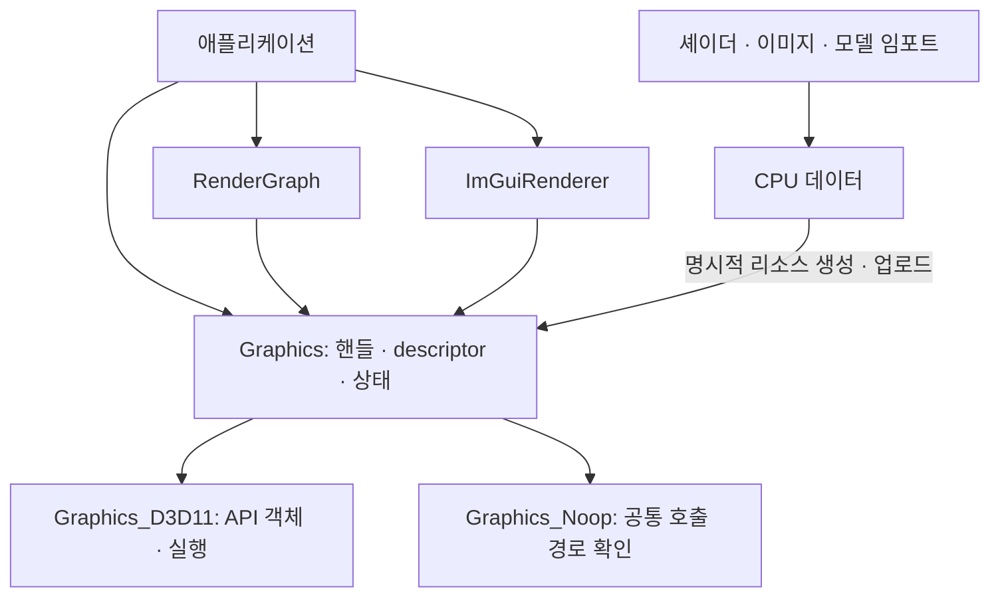

# JugGfx

**Direct3D 11 기반 C++20 그래픽스 라이브러리**

버퍼·텍스처·셰이더 생성, 드로우·컴퓨트 실행, 렌더 패스 구성과 이미지·모델 임포트를 제공합니다. [JugX](https://github.com/JuggernautSensei/JugX)의 핸들·컨테이너·수학·오류 타입을 사용하며, 애플리케이션은 `Graphics`를 통해 GPU 리소스를 다룹니다.

현재 백엔드는 **D3D11**과 **Noop**, 빌드 대상은 **Windows x64**입니다.

[설계](#설계) · [시작하기](#시작하기) · [Graphics](#graphics) · [RenderGraph](#rendergraph) · [Resource](#resource) · [Geometry](#geometry) · [ImGui](#imgui) · [Base / Error](#base--error) · [빌드](#빌드)

## 주요 기능

| 필터 | 기능 |
| --- | --- |
| `Graphics` | 정점·인덱스·인스턴스·상수·스토리지 버퍼, 2D·3D·큐브 텍스처, 프레임버퍼, 상태 설정, 드로우·컴퓨트·간접 실행 |
| `Graphics/DirectX` | D3D11 디바이스·컨텍스트, DXGI 스왑체인, 상태 객체 캐시, 디버그·GPU 통계 |
| `RenderGraph` | 렌더·컴퓨트·유틸리티 패스, 이름 기반 리소스 연결, 패스 컬링, 바인딩 충돌 정리 |
| `Resource/Shader` | Slang 소스·파일 컴파일, DXBC 바이트코드 |
| `Resource/Image` | 이미지 import/export, mip·레이어·볼륨·큐브맵 데이터, BC 압축 해제 |
| `Resource/Model` | glTF·GLB·FBX·OBJ, 메시·머티리얼·텍스처·노드·스킨·모프·애니메이션 데이터 |
| `Geometry` | 기본 도형 메시 생성, 노멀·탄젠트·바이탄젠트 계산 |
| `ImGui` | SDL3 입력과 JugGfx 렌더링 연결, docking·다중 viewport |
| `Base`, `Error` | 플랫폼 헤더와 그래픽스 오류 코드 |

## 설계

### Graphics는 공통 상태를, 백엔드는 API 객체를 관리합니다

[Graphics](JugGfx/Graphics.h)는 리소스 생성 조건, 핸들 발급, descriptor 저장, 바인딩 상태와 사용 통계를 관리합니다. 생성·파괴·업데이트·실행의 API 의존 부분은 protected 가상 함수로 백엔드에 위임합니다.

[Graphics_D3D11](JugGfx/Graphics_D3D11.h)은 같은 핸들에 대응하는 D3D 버퍼·텍스처·뷰·셰이더와 디바이스·컨텍스트를 보관합니다. 공통 descriptor에 D3D 객체 포인터를 넣지 않으므로 상태 관리와 핸들 검사는 백엔드가 바뀌어도 같은 경로를 사용합니다.

[Graphics_Noop](JugGfx/Graphics_Noop.h)은 GPU 명령을 실행하지 않으면서 공통 리소스·상태 관리 경로를 사용합니다. 버퍼 map에는 버퍼별 CPU 저장 공간을 제공해 GPU 없이 호출 흐름을 확인할 수 있습니다. 실제 픽셀 결과는 D3D11에서 확인해야 합니다.



`Graphics` 인스턴스는 하나를 전제로 하며 `GetSingleton()`으로 접근합니다. 현재 드로우·컴퓨트는 호출 스레드에서 백엔드로 전달됩니다. 별도 렌더 스레드나 드로우 정렬 큐를 두지 않습니다.

### 상태를 쌓고 실행할 때 변경분을 반영합니다

`SetVertexBuffer()`·`SetProgram()`·`SetRenderState()` 등은 공통 `PipelineState`를 변경합니다. 상태 종류별 dirty 비트와 셰이더 스테이지별 바인딩의 변경 범위를 기록합니다.

D3D11의 `ApplyPipeline_()`은 이 정보를 사용해 필요한 상태를 반영합니다. 핸들을 D3D 포인터 배열로 바꾼 미러를 유지하고, 바인딩은 변경 범위를 묶어 `*Set*Resources()` 등에 전달합니다. 입력 레이아웃·래스터라이저·블렌드·깊이 스텐실·샘플러 상태 객체는 캐시합니다.

`Submit()`은 인덱스·인스턴스 버퍼의 바인딩에 따라 드로우 방식을 선택합니다. `Dispatch()`는 컴퓨트 상태를 실행하고, `Touch()`는 드로우 없이 상태만 반영합니다. 설정한 상태는 다음 호출에도 유지되며 `Reset()`은 공통 상태를 초기화하고 다시 적용하도록 표시합니다.

### 핸들 복사와 리소스 소유권은 구분합니다

리소스 핸들은 [JugX의 타입별 32비트 핸들](Vendor/JugX/JugX/Handle.h)입니다. `TextureHandle`·`ShaderHandle`처럼 종류를 구분하며, 핸들 값의 복사만으로 참조 수가 늘거나 소멸 시 리소스가 해제되지는 않습니다. GPU 리소스는 `Graphics::Destroy()`로 정리합니다.

프레임버퍼는 attachment 텍스처를, 프로그램은 구성 셰이더를 참조합니다. 생성 함수의 `bOwnership`은 이 관계에서 호출자 소유 참조를 어떻게 처리할지 정합니다.

| `bOwnership` | 프레임버퍼·프로그램 생성 시 | 호출자 책임 |
| --- | --- | --- |
| `false` (기본값) | 구성 리소스의 참조 수를 추가 | 호출자가 가진 참조도 별도로 `Destroy()` |
| `true` | 호출자 참조를 넘겨받음 | 넘긴 참조를 다시 파괴하지 않음 |

프레임버퍼·프로그램 파괴 시 구성 리소스의 참조를 해제합니다. 텍스처·셰이더는 마지막 참조가 없어질 때 백엔드 객체와 핸들 저장소에서 제거됩니다. 사용 중인 리소스를 파괴할 때는 공통 바인딩도 정리합니다.

모든 리소스와 `RenderGraph`·`ImGuiRenderer`처럼 Graphics를 사용하는 객체는 Graphics 인스턴스보다 먼저 정리해야 합니다. `ReportLiveObjects()`는 남아 있는 리소스를 보고합니다.

### 임포트 결과는 CPU 데이터로 유지합니다

이미지·모델을 읽는 과정에서 그래픽스 디바이스를 만들거나 GPU 버퍼를 자동 생성하지 않습니다. 이미지 임포터는 `Image`, 모델 임포터는 `Model`, 셰이더 컴파일러는 `ShaderBytecode`를 반환합니다.

애플리케이션이 이 데이터를 어떤 정점 레이아웃·텍스처·프로그램으로 올릴지 결정합니다. 파일 해석, CPU 데이터 소유권, GPU 리소스 수명을 각각 다룰 수 있도록 경계를 나눈 구조입니다.

### 계약 위반과 외부 입력 실패를 나눕니다

핸들 유효성, 슬롯 범위, 리소스 용도·크기, 바인딩 조합 등의 전제조건은 호출자가 보장하며 위반은 `JUG_ASSERT`로 드러냅니다. assertion은 기본적으로 Debug에서 활성화되고, 꺼져 있어도 호출 계약은 유지됩니다.

파일·외부 이미지·모델·셰이더 소스의 해석 실패는 `Error`·`Result<T>`로 반환합니다. D3D 호출 실패를 처리하는 `JUG_DX_CHECK`는 진단 후 치명적 오류 경로로 연결됩니다. GPU 생성 함수 전부가 복구 가능한 `Result`를 반환하는 API는 아닙니다.

## 시작하기

[통합 헤더](JugGfx/JugGfx.h)는 `<JugGfx/JugGfx.h>`로 포함합니다. 아래 예제는 라이브러리와 의존성을 연결한 프로젝트를 기준으로 합니다.

### SDL 윈도우에 한 프레임 출력

호출 전에 SDL과 윈도우가 초기화되어 있어야 하며, 다른 Graphics 인스턴스가 없어야 합니다. 너비·높이는 실제 렌더 대상의 픽셀 크기입니다.

```cpp
#include <JugGfx/JugGfx.h>

void ClearWindowOnce(SDL_WindowID window, uint32_t width, uint32_t height)
{
    jug::Graphics_D3D11 gfx { jug::kNoneFlags };
    const auto target = gfx.CreateFrameBuffer(
        window, width, height, jug::eTextureFormat::RGBA8_UNorm, 2);

    gfx.ClearRenderTarget(target, jug::RGBA { 30, 30, 35, 255 });
    gfx.Frame();

    gfx.Destroy(target);
}
```

`Frame()`은 생성된 스왑체인의 present, 통계 갱신과 readback 완료 처리를 진행합니다. 실제 앱에서는 Graphics와 프레임버퍼를 초기화 시 만들고 프레임마다 재사용합니다. 창 크기 변경은 `ResizeFrameBuffer()`, 수직 동기화는 `SetVSync()`로 설정합니다.

## Graphics

### 버퍼와 정점 레이아웃

[VertexLayout](JugGfx/VertexLayout.h)은 속성의 의미·형식·개수·정규화 여부를 받아 offset과 stride를 구성하고 레이아웃 해시를 계산합니다. CPU 메시의 저장 방식과 GPU에 전달할 정점 형식을 연결하는 기준입니다.

| 리소스 | 주요 용도 |
| --- | --- |
| Vertex / Index buffer | 정점 스트림과 16·32비트 인덱스 |
| Instance buffer | 인스턴스별 데이터 |
| Constant buffer | 셰이더 스테이지별 상수 |
| Structured buffer | 셰이더 읽기·읽기/쓰기 데이터 |
| Indirect buffer | GPU가 참조하는 draw·dispatch 인자 |
| Readback buffer | GPU 데이터의 CPU 읽기용 staging 저장소 |

`UpdateBuffer()`·`MapBuffer()`·`UnmapBuffer()`·`CopyBuffer()`는 [BufferRef](JugGfx/Base.h)를 통해 버퍼 종류를 공통으로 전달받습니다. 정점 바인딩은 여러 스트림과 인스턴스 데이터를 지원합니다. 슬롯·범위와 dynamic·readback 등 리소스 용도는 각 함수의 계약에 맞아야 합니다.

### 드로우와 컴퓨트

다음 예제는 생성된 정점·인덱스 버퍼와 호환되는 프로그램, 프레임버퍼를 전달받아 indexed draw를 실행합니다.

```cpp
#include <JugGfx/JugGfx.h>

void DrawMesh(jug::Graphics& gfx, jug::FrameBufferHandle target,
              jug::ProgramHandle program, jug::VertexBufferHandle vertices,
              jug::IndexBufferHandle indices, uint32_t width, uint32_t height)
{
    gfx.Reset();
    gfx.SetFrameBuffer(target);
    gfx.SetViewport(0.f, 0.f, static_cast<float>(width), static_cast<float>(height));
    gfx.SetProgram(program);
    gfx.SetVertexBuffer(vertices);
    gfx.SetIndexBuffer(indices);
    gfx.SetRenderState(jug::eRenderState::Topology_TriangleList);
    gfx.Submit();
}
```

프레임의 드로우가 끝나면 호출자가 `Frame()`을 실행합니다. 컴퓨트는 `CreateComputeProgram()`·`SetComputeProgram()`·`Dispatch()`로 사용하며, indirect 버퍼를 받는 `Submit()`·`Dispatch()` 오버로드도 제공합니다.

### 텍스처와 프레임버퍼

[Texture.h](JugGfx/Texture.h)는 텍스처 포맷과 블록 크기·행 크기 등의 계산을 제공합니다. 텍스처 생성은 2D·3D·큐브맵, 배열 레이어, mip 저장 공간과 MSAA 옵션을 다룹니다. 읽기·쓰기·render target·depth stencil 등 사용 목적은 생성 시 지정합니다.

프레임버퍼는 attachment의 mip·레이어 범위를 지정하거나 SDL 윈도우에 대응하는 스왑체인으로 생성합니다. 컬러·깊이 attachment, clear, resize와 MSAA resolve는 Graphics 경로에서 처리합니다.

### Readback — 요청과 CPU 복사 시점 분리

GPU 데이터를 staging 리소스에 복사한 뒤 `ReadBuffer()`·`ReadTexture()`로 읽기를 요청합니다. 반환값은 **출력 메모리가 채워지는 frame index**이며 `GetFrameIndex()`로 완료 여부를 판단합니다.

```cpp
#include <JugGfx/JugGfx.h>

uint64_t QueueCapture(jug::Graphics& gfx, jug::TextureHandle source,
                      jug::TextureHandle staging, jug::MutableMemoryView pixels)
{
    gfx.CopyTexture(staging, source);
    return gfx.ReadTexture(staging, pixels);
}
```

예제의 `staging`은 source와 복사 가능한 크기·형식이며 `eTextureOption::Readback`으로 생성된 텍스처입니다. `pixels`는 해당 subresource를 담을 크기여야 합니다.

호출자는 완료 frame index에 도달할 때까지 출력 메모리를 유지하고, 요청 중인 staging 리소스를 파괴하거나 복사 대상으로 다시 사용하지 않아야 합니다. 완료 처리는 `Frame()`에서 수행합니다. D3D11의 실제 map 시점에는 GPU 작업을 기다릴 수 있으므로 모든 호출이 무대기라는 보장은 없습니다.

## RenderGraph

[RenderGraph](JugGfx/RenderGraph.h)는 패스 설정과 리소스 연결을 보관합니다. `Graphics`를 직접 호출하는 대신, 프레임 간 재사용할 패스를 구성할 때 사용합니다.

| 패스 | 선언하는 내용 | executor 역할 |
| --- | --- | --- |
| Render | 프로그램, 프레임버퍼, viewport, clear, render state, 바인딩 | 정점·인덱스 설정과 드로우 등 패스의 작업 |
| Compute | 프로그램, 읽기·읽기/쓰기 리소스, 상수, 샘플러 | dispatch 등 작업 |
| Utility | 활성화 여부와 executor | 복사 등 필요한 호출 직접 실행 |

### 선언 → 컴파일 → 실행

`Insert()`로 핸들을 이름에 연결하고 builder로 패스를 선언합니다. `Execute()`는 구성이 바뀐 경우 `Compile_()`을 거쳐 이름을 핸들로 해석하고 실행 목록을 만듭니다.

1. 최종 출력·side effect·utility 패스를 실행 대상으로 잡습니다. 최종 출력 표시가 없으면 마지막 활성 render·compute 패스를 사용합니다.
2. 필요한 리소스를 쓰는 패스를 역방향으로 찾아 살리고 나머지를 컬링합니다.
3. 같은 리소스의 읽기·읽기/쓰기·attachment 바인딩이 충돌하는지 검사하고 패스 사이의 unbind 계획을 만듭니다.
4. 살아남은 패스를 **등록 순서대로** 실행합니다. 다음 프레임으로 이어지는 바인딩 상태도 고려합니다.

패스 순서를 자동 위상 정렬하거나 임시 텍스처 메모리를 aliasing하는 구조는 아닙니다. 등록 순서와 패스 간 리소스 연결은 호출자가 정합니다. Utility executor 안의 리소스 접근은 자동 추론하지 않습니다.

```cpp
#include <JugGfx/JugGfx.h>

void ConfigureGraph(jug::RenderGraph& graph, jug::FrameBufferHandle target,
                    jug::ProgramHandle program, const jug::Callable<void()>& draw)
{
    graph.Insert("output", target);
    graph.Insert("mesh-program", program);
    graph.AddRenderPass("main")
        .SetFrameBuffer("output")
        .SetProgram("mesh-program")
        .ClearRenderTarget(jug::RGBA { 30, 30, 35, 255 })
        .SetExecutor(draw)
        .AsFinalOutput();
}
```

구성 후 프레임마다 `graph.Execute()`와 `gfx.Frame()`을 호출합니다. executor는 바인딩된 패스 상태에서 정점·인덱스 설정과 `Submit()` 등을 수행합니다.

`RenderGraph::Insert()`의 `bOwnership=false`는 핸들을 빌려 등록한다는 뜻입니다. Graphics의 프로그램·프레임버퍼 생성 옵션과 달리 참조 수를 추가하지 않습니다. `true`로 등록하면 그래프의 제거·정리 시 `Destroy()`하며, 빌린 리소스는 그래프가 사용하는 동안 호출자가 유지합니다.

## Resource

### Shader — Slang 컴파일과 GPU 셰이더 생성

[Shader.h](JugGfx/Shader.h)의 컴파일 함수는 소스·파일을 읽어 현재 타깃인 **DXBC / Shader Model 5.0**을 생성합니다. Vertex·Pixel·Compute 스테이지, entry point, 매크로, include 경로와 컴파일 옵션을 지정합니다.

```cpp
#include <JugGfx/JugGfx.h>

jug::Result<jug::ShaderBytecode> CompileVertexShader(jug::StringView source)
{
    jug::ShaderCompileConfig config;
    config.type = jug::eShader::Vertex;
    config.entryPoint = "VSMain";
    config.flags = jug::eShaderCompileOption::MatrixLayout_Row;
    return jug::CompileShader(source, config);
}
```

`ShaderBytecode`는 `ISlangBlob`을 소유하는 이동 전용 데이터입니다. 컴파일 결과를 바이트 배열로 다시 복사하지 않고, `Graphics::CreateShader()`가 이를 받아 GPU 셰이더를 만듭니다. 동일 바이트코드는 해시 캐시를 통해 셰이더 핸들을 재사용하고 참조 수를 증가시킵니다.

CPU 행렬 배치와 셰이더의 행렬 배치·곱셈 순서는 일치시켜야 합니다. 기본 컴파일 옵션은 column-major이고 위 예제는 row-major를 명시합니다. 내부 Slang global session은 여러 스레드에서 동시에 사용하도록 동기화되어 있지 않으므로 컴파일 호출은 한 스레드에서 수행합니다.

### Image — 픽셀 소유권과 subresource 표현

| 타입 | 역할 |
| --- | --- |
| [ImageDesc](JugGfx/Image.h) | 크기·깊이·레이어·mip, 채널 형식·개수, sRGB, GPU 포맷 정보 |
| `PixelBuffer` | 픽셀 메모리를 소유하는 malloc 기반 이동 전용 버퍼 |
| `Image` | descriptor와 픽셀 버퍼 소유, layer·mip별 데이터 조회 |
| `SubImage` | 크기·row pitch·slice pitch와 비소유 픽셀 뷰 |

픽셀은 `layer * numMips + mip` 순서로 배치합니다. `GetSubImage()`는 원본 메모리의 뷰를 반환하므로 `Image`보다 오래 유지할 수 없습니다. `CalcRowPitch()`·`CalcSlicePitch()`는 BC 압축일 때 픽셀이 아닌 블록 단위로 크기를 계산합니다.

[ImageImporter](JugGfx/ImageImporter.h)는 stb로 PNG·JPEG·BMP·TGA·HDR·GIF, tinyexr로 EXR, 별도 파서로 DDS를 읽습니다. GIF의 프레임은 레이어로 저장합니다. DDS의 BC 압축 데이터는 유지하거나 bcdec로 해제할 수 있습니다.

```cpp
#include <JugGfx/JugGfx.h>

jug::Result<jug::Image> LoadColorImage(const jug::FilePath& path)
{
    return jug::ImportImageFromFile(path, {
        jug::eImageImportOption::SRGB,
        jug::eImageImportOption::GpuCompatible,
    });
}
```

`SRGB`는 색공간 정보가 없는 8비트 3·4채널 입력을 sRGB로 해석합니다. `GpuCompatible`은 3채널을 4채널로 패딩하는 등 텍스처 생성에 맞게 정규화하고 GPU 한계를 넘는 입력은 거부합니다. `gpuFormat`은 선택적 값이며 변환할 수 있는 GPU 포맷이 없으면 비어 있습니다.

[ImageExporter](JugGfx/ImageExporter.h)는 PNG·JPEG·BMP·TGA·HDR·EXR·DDS로 메모리 또는 파일에 저장합니다. 단일 이미지 포맷에는 layer·mip을 선택하고 DDS에는 여러 subresource를 담을 수 있습니다. EXR은 지원하는 채널·저장 형식에 제한이 있으며 multipart·deep·tiled EXR은 지원하지 않습니다.

### Model — 포맷을 공통 CPU 데이터로 변환

[ModelImporter](JugGfx/ModelImporter.h)는 glTF·GLB를 cgltf로, FBX·OBJ를 ufbx로 해석한 뒤 [Model](JugGfx/Model.h)로 변환합니다.

| 데이터 | 표현 |
| --- | --- |
| 메시 | 위치·노멀·탄젠트·색상·UV·본 인덱스·가중치를 각각 배열로 저장 |
| 인덱스 | 32비트 삼각형 리스트 |
| 머티리얼 | 색·metallic·roughness 등 값과 의미별 텍스처 슬롯·샘플러·UV 변환 |
| 노드 | local `TRANSFORM`과 부모·메시 그룹·스킨 인덱스 |
| 스킨 | 본 노드 인덱스와 inverse bind 행렬 |
| 모프 | 위치·노멀·탄젠트 델타와 가중치 |
| 애니메이션 | translation·rotation·scale·모프 가중치 커브 |

정점 속성은 SoA 배열이며 없는 속성은 빈 배열로 표현합니다. 출력 좌표는 **왼손 좌표계, +Y up, 시계 방향 앞면**으로 맞춥니다. 단위는 미터로 정규화한 뒤 `unitScale`을 적용합니다. 정점당 본 영향은 최대 4개를 남기고 가중치를 재정규화합니다.

```cpp
#include <JugGfx/JugGfx.h>

jug::Result<jug::Model> LoadModel(const jug::FilePath& path)
{
    jug::ModelImportConfig config;
    config.unitScale = 1.f;
    config.sampleRate = 30.f;
    return jug::ImportModelFromFile(path, config);
}
```

`sampleRate`는 FBX 애니메이션 bake에 사용하며 glTF는 원본 키를 유지합니다. Skip 옵션으로 메시·머티리얼·텍스처·스킨·모프·애니메이션 로드를 조절할 수 있습니다.

메모리 입력 `ImportModel()`은 GLB·data URI·내장 리소스처럼 메모리 안에서 해결되는 입력용입니다. 외부 `.bin`·텍스처 경로를 읽어야 하면 `ImportModelFromFile()`을 사용합니다. GPU 업로드, 애니메이션 재생과 스킨 행렬 구성은 사용하는 코드에서 처리합니다.

## Geometry

[Geometry.h](JugGfx/Geometry.h)는 박스·구·원기둥·원뿔·평면·캡슐 메시를 `Geometry`로 반환합니다. 지정한 `VertexLayout`에 맞춰 정점·인덱스 바이트 버퍼를 구성하며 GPU 버퍼는 생성하지 않습니다.

[TangentFrame.h](JugGfx/TangentFrame.h)는 위치·UV·인덱스로 노멀 또는 탄젠트·바이탄젠트 배열을 계산합니다. 16·32비트 인덱스 오버로드를 제공합니다. 모델 임포트의 탄젠트는 `VEC4`이며 w는 `bitangent = Cross(N, T.xyz) * w`의 부호를 표현합니다. 셰이더에서 사용할 표현에 맞춰 연결합니다.

## ImGui

[ImGuiRenderer](JugGfx/ImGuiRenderer.h)는 Dear ImGui의 SDL3 플랫폼 바인딩과 JugGfx 렌더링을 연결합니다. `Begin()`·`End()`로 프레임을 진행하고 `OnSystemEvent_()`로 SDL 이벤트를 전달합니다.

draw data는 동적 정점·인덱스 버퍼에 올리고, clip rect는 scissor로 적용합니다. docking과 선택적인 다중 viewport를 지원하며 추가 윈도우에는 별도 프레임버퍼를 사용합니다. ImGuiRenderer는 Graphics가 살아 있는 동안 생성·사용·파괴해야 합니다.

## Base / Error

[GraphicsInclude.h](JugGfx/GraphicsInclude.h)는 D3D11·DXGI 헤더와 플랫폼 설정을 모읍니다. [DXGI.h](JugGfx/DXGI.h)는 포맷·API 타입 변환을, [DxMacro.h](JugGfx/DxMacro.h)는 D3D 호출 검사와 객체 해제 도구를 제공합니다. [Base.h](JugGfx/Base.h)는 핸들, descriptor, 상태 플래그, 바인딩 참조, caps·stats를 정의합니다.

[Error.h](JugGfx/Error.h)의 `eGraphicsError`는 셰이더 컴파일, 이미지·모델 파싱, 미지원 형식·기능, 누락된 외부 리소스 등의 실패를 구분합니다. `GraphicsCategory`가 JugX의 오류 범주와 연결합니다.

## 빌드

### 환경과 의존성

- Windows x64, Visual Studio 2026 C++ 도구(`v145`), Windows SDK.
- C++20, vcpkg MSBuild 통합, Python 3. Python은 빌드 후 통합 헤더 생성에 사용합니다.
- `JugGfx.slnx`와 `JugGfx.vcxproj`를 제공합니다. 정적 라이브러리 프로젝트입니다.

| 의존성 | 용도 | 위치 |
| --- | --- | --- |
| JugX | 공통 타입·수학·핸들·오류·파일 기능 | Git submodule |
| SDL3, spdlog, parallel-hashmap | 윈도우 연동·로그·해시 컨테이너 | vcpkg |
| shader-slang | DXBC 셰이더 컴파일 | vcpkg, manifest 버전 고정 |
| stb, tinyexr | 이미지 읽기·쓰기 | vcpkg |
| cgltf | glTF·GLB | vcpkg |
| Dear ImGui, ImGuizmo | GUI·편집 도구 | vcpkg |
| ufbx, bcdec | FBX·OBJ, BC 압축 해제 | `Vendor/`에 포함 |

### 받기와 컴파일

```powershell
git clone --recurse-submodules https://github.com/JuggernautSensei/JugGfx.git
cd JugGfx
```

vcpkg를 설치하고 `vcpkg integrate install`로 MSBuild 통합을 활성화합니다. Visual Studio에서 `JugGfx.slnx`를 열어 x64 구성을 선택하거나, Visual Studio 개발자 PowerShell에서 실행합니다.

```powershell
msbuild JugGfx.slnx /t:Vendor\JugX\JugX /p:Configuration=Debug /p:Platform=x64
msbuild JugGfx.slnx /t:JugGfx /p:Configuration=Debug /p:Platform=x64
```

Release는 `Configuration=Release`로 변경합니다. manifest 의존성은 vcpkg가 설치하며 출력 라이브러리는 `Build/x64/Debug/` 또는 `Build/x64/Release/`에 생성됩니다.

### 사용하는 프로젝트에 연결

JugGfx와 JugX 프로젝트를 솔루션에 추가하고 참조하거나 출력된 `.lib`를 연결합니다. 헤더 탐색 경로에는 JugGfx 저장소 루트와 `Vendor/JugX`를 추가하고, 같은 vcpkg triplet·빌드 구성의 의존성을 연결합니다. 공통 정의는 통합 헤더 또는 프로젝트 PCH에서 먼저 포함합니다.

여러 라이브러리가 JugX를 공유한다면 헤더와 링크할 라이브러리를 같은 버전으로 맞춥니다. 실행 시 SDL3·Slang 등 동적 의존성도 배포해야 하며, 런타임 셰이더 컴파일에는 Slang의 컴파일러 모듈이 필요합니다.

### 진단

`eGraphicsOption::Debug`는 D3D11 debug layer를, `ProfileFrameTime`·`ProfileGpuMemory`는 GPU 시간·메모리 수집을 켭니다. `GetCaps()`는 디바이스 정보, `GetStats()`는 프레임의 draw·dispatch·resolve와 프로파일링 정보를 제공합니다. 디버그 그룹·마커·리소스 이름과 `ReportLiveObjects()`를 사용해 호출과 수명을 확인할 수 있습니다.
